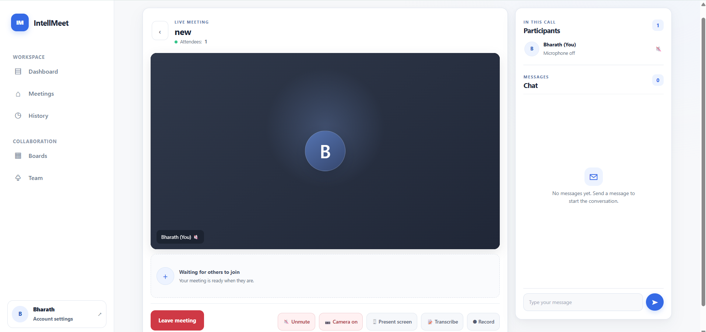
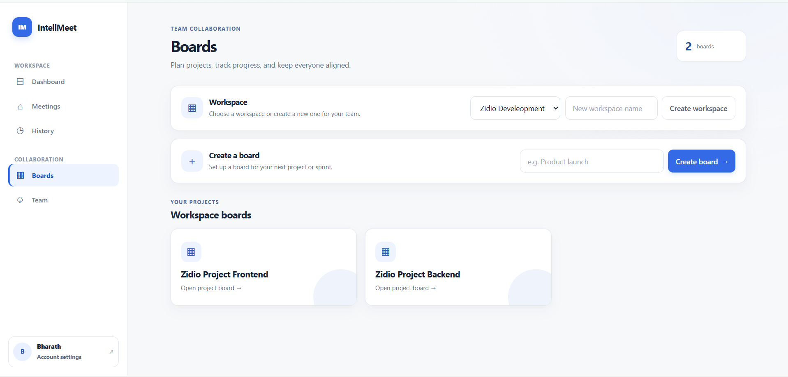
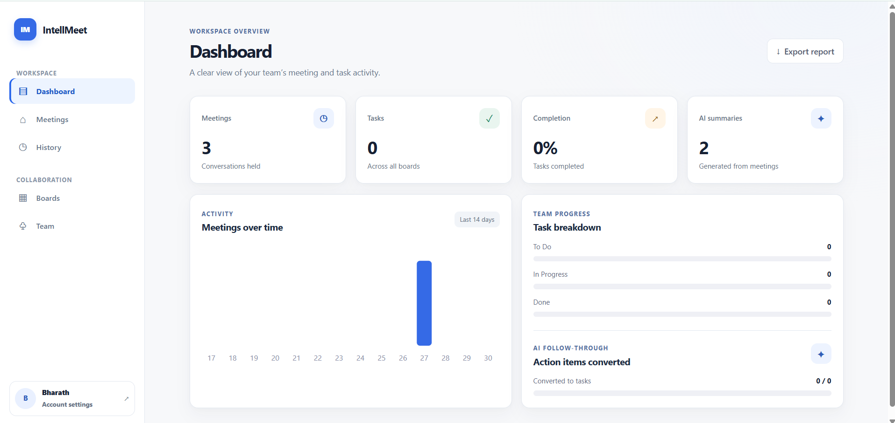

# IntellMeet: AI-Powered Enterprise Meeting & Collaboration Platform

Real-time video meetings, AI summaries with action items, team boards and analytics, built with the MERN stack for the Zidio Development / LogicVeda web development program.

- **Live demo:** https://intell-meet-ai-powered-enterprise-m-wine.vercel.app
- **API health check:** https://intellmeet-ai-powered-enterprise-meeting-adtr.onrender.com/health
- **Demo account:** click **"Try the demo account"** on the login page (no sign-up needed)
- **Demo video:** `[add your link here]`
- **Project report (PDF):** `docs/` folder

> The backend runs on Render's free plan, which sleeps when idle. The first request after a quiet period can take 30 to 60 seconds.

## Screenshots

| Meeting room | Boards | Dashboard |
|---|---|---|
|  |  |  |

## Features

| ID | Feature | What it does |
|---|---|---|
| F-01 | Authentication and profiles | Email signup/login, optional Google sign-in, JWT access and refresh tokens, profile photo and name |
| F-02 | Real-time video meetings | WebRTC video and audio, pre-join lobby, mute/camera controls, Google Meet-style screen presenting, recording |
| F-03 | AI meeting intelligence | Browser speech transcription, AI summary and action items with assignees (mock mode needs no API key) |
| F-04 | Chat and collaboration | In-meeting chat with typing indicators, presence, live notifications |
| F-05 | Post-meeting dashboard | Searchable history, summary, transcript, recordings, export to .txt, one-click tasks from action items |
| F-06 | Teams and projects | Workspaces, roles, Kanban boards with drag-and-drop and live updates |
| F-07 | Analytics | Meetings per day, task status, completion rate, AI usage, CSV export |
| Extra | Sharing and scheduling | Invite links, invite a whole team, schedule meetings, reschedule, 10-minute reminders, add to calendar |

## Tech stack

| Layer | Technology |
|---|---|
| Frontend | React 19, Vite, plain CSS, socket.io-client |
| Backend | Node.js, Express, Zod, Helmet, express-rate-limit |
| Database | MongoDB (Mongoose), GridFS for recordings |
| Real-time | Socket.io (signalling, chat, presence), WebRTC (media) |
| AI | Any OpenAI-compatible provider, or built-in mock mode |
| Cache (optional) | Redis, Socket.io Redis adapter |
| Auth | JWT, bcrypt, Google ID-token verification |
| Testing | Jest, Supertest, socket.io-client |
| DevOps | Docker (multi-stage), GitHub Actions, Render, Vercel, MongoDB Atlas |

## Architecture

```
React client (Vercel) --HTTPS REST--> Express API (Render) --> MongoDB Atlas (+ GridFS)
        |  \--WebSocket (Socket.io)-->   |  \--> AI provider (or mock)
        |                                \--> Redis (optional: cache + Socket.io adapter)
        \--WebRTC (peer-to-peer, STUN/TURN)--> other participants
```

## Repository layout

```
backend/    Express API, Socket.io, tests, Dockerfile
frontend/   React app (Vite), Dockerfile, nginx config
docs/       Project report, testing notes, screenshots
.github/    CI workflow
render.yaml, docker-compose.yml
```

## Run locally

Requirements: Node.js 24 and MongoDB (local, or an Atlas connection string).

```bash
# backend
cd backend
npm install
cp .env.example .env        # then fill in the values below
npm run dev                 # http://localhost:5000

# frontend (second terminal)
cd frontend
npm install
cp .env.example .env        # VITE_API_URL=http://localhost:5000
npm run dev                 # http://localhost:5173
```

Or with Docker: `docker compose up --build`, then open http://localhost:5173.

### Backend environment variables

| Variable | Required | Notes |
|---|---|---|
| `MONGO_URI` | yes | e.g. `mongodb://127.0.0.1:27017/intellmeet` |
| `JWT_ACCESS_SECRET`, `JWT_REFRESH_SECRET` | yes | two different long random strings |
| `CLIENT_URL` | yes | frontend address(es), comma-separated, no trailing slash |
| `PORT` | no | default 5000 |
| `AI_MODE` | no | `mock` (default, no key) or `openai` |
| `AI_API_KEY`, `AI_BASE_URL`, `AI_MODEL` | only for `openai` mode | any OpenAI-compatible provider |
| `REDIS_URL` | no | enables caching and the Socket.io adapter |
| `GOOGLE_CLIENT_ID` | no | enables Google sign-in |
| `MONGO_URI_TEST` | for tests | a database whose name contains `test` |

Frontend: `VITE_API_URL` (required), `VITE_GOOGLE_CLIENT_ID` (optional), `VITE_TURN_URL`, `VITE_TURN_USER`, `VITE_TURN_PASS` (optional TURN server for video across networks).

## Tests

```bash
cd backend
npm test                    # unit + integration tests
npm run test:coverage       # with coverage report
```

Integration tests run only when `MONGO_URI_TEST` is set. They use their own databases and refuse to run against a database whose name does not contain "test". The CI workflow runs everything against a MongoDB service container.

Load and security testing notes are in [`docs/TESTING.md`](docs/TESTING.md).

## API overview

All routes are under `/api/v1`. Protected routes need `Authorization: Bearer <accessToken>`.

| Area | Endpoints |
|---|---|
| Auth | `POST /auth/signup`, `/auth/login`, `/auth/refresh`, `/auth/logout`, `/auth/google`, `GET /auth/me` |
| Profile | `PATCH /users/me`, `PUT /users/me/avatar` |
| Meetings | `POST/GET /meetings`, `GET/PATCH/DELETE /meetings/:id`, `POST /meetings/:id/join` |
| Invites | `POST /meetings/:id/invite`, `GET /meetings/invite/:code`, `POST /meetings/invite/:code/join`, `POST /meetings/:id/invite-workspace` |
| AI | `POST /meetings/:id/transcript`, `/summarize`, `GET /meetings/:id/summary`, `POST /meetings/:id/action-items/convert` |
| Recordings | `POST/GET /meetings/:id/recordings`, `GET /meetings/:id/recordings/:rid` |
| Tasks | `GET/POST /tasks`, `PATCH/DELETE /tasks/:id` |
| Teams | `/workspaces`, `/workspaces/:id/members`, `/workspaces/:id/boards`, `/boards/:id`, `/boards/:id/tasks` |
| Analytics | `GET /analytics/overview` |

Socket.io events: `meeting:join`, `meeting:leave`, `signal`, `chat:message`, `chat:typing`, `media:state`, `recording:state`, plus server pushes such as `board:update`, `task:assigned`, `summary:ready`, `meeting:invited` and `meeting:reminder`.

## Security

JWT access tokens (15 minutes) with rotating refresh tokens stored as hashes, bcrypt password hashing, Zod validation on every body, role and membership checks on every resource, rate limiting on auth routes, Helmet headers, a CORS allow-list, size limits on uploads, JPEG signature checks on avatars, and secrets only in environment variables. See the report for the OWASP Top 10 mapping.

## Known limitations

- Video is peer-to-peer (mesh), which suits small meetings. Large meetings would need a media server such as LiveKit or mediasoup.
- Recording captures the recording user's browser tab, so it reflects one person's view.
- Application-level end-to-end encryption is not implemented. WebRTC media is encrypted in transit; chat and transcripts are stored on the server.
- Reminders are in-app pop-ups, not email or push notifications.
- Kubernetes/Helm manifests, Prometheus/Grafana and Sentry from the original plan are not implemented.

## License and credits

Built as a project submission for Zidio Development / LogicVeda. Author: `[your name]`.
